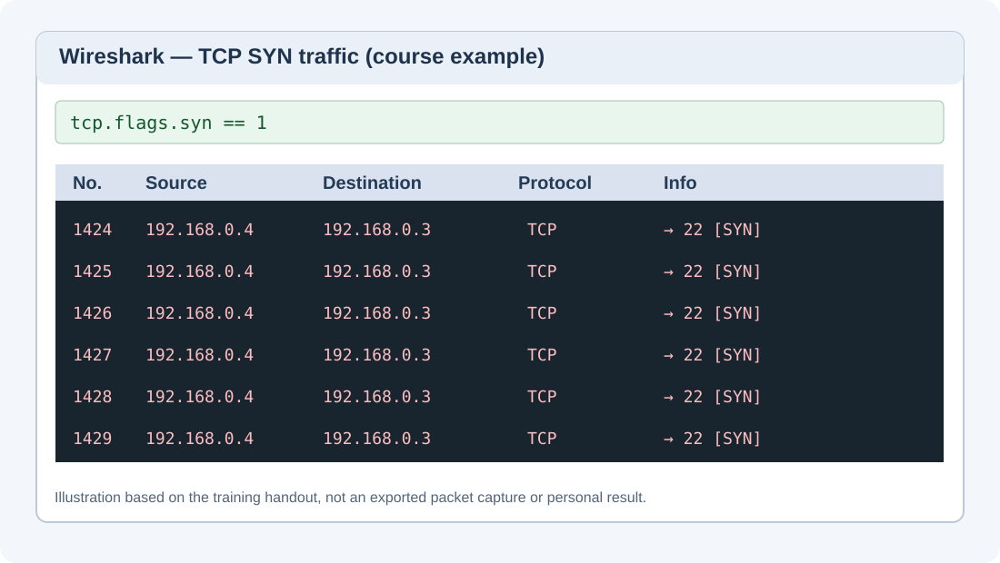

# DoS/DDoS Exercise — TCP SYN Flood Observation

**Course area:** Ethical Hacking and Network Defense  
**Lab platform:** ACI / Infosec Learning  
**Status:** Exercise documentation in progress; personal results not yet verified

## Purpose

This exercise introduces denial-of-service (DoS) behavior using TCP SYN traffic and Wireshark. The focus is on understanding how a high volume of connection requests can affect a target system and how to recognize that traffic in a packet capture.

This is a separate hosted training environment from my VirtualBox host-only Kali/Metasploitable setup documented in the main README.

## Lab environment (from the exercise instructions)

| Role | Training device | Address shown in the instructions |
| --- | --- | --- |
| Traffic source | ACIKALI | 192.168.0.4 |
| Windows target | ACIWIN11 | 192.168.0.3 |
| Analyzer | Wireshark on ACIWIN11 | Ethernet0 |
| Protocol under observation | TCP | SYN packets; destination port 22 |

These addresses and the displayed screenshots come from the course instructions; they are **not yet evidence of my own results**.

## Visual reference

*Figure 1. Recreated illustration of the Wireshark SYN packet table shown in the Infosec Learning instructions. This is not an original capture from my lab session.*

## What the exercise demonstrates

1. A TCP connection normally begins with a SYN packet and continues through the TCP handshake.
2. A very high volume of SYN requests can consume connection-handling resources and interfere with availability.
3. Wireshark can show repeated TCP packets, including the SYN flag, source and destination addresses, and destination port.
4. System behavior such as delay, unresponsiveness, or recovery after traffic ends can be documented as evidence when actually observed.

## Observation checklist

- [ ] Verify the devices in the assigned training environment.
- [ ] Inspect the Wireshark capture on the designated Windows interface.
- [ ] Record whether repeated TCP SYN packets are visible.
- [ ] Note any observed system responsiveness changes.
- [ ] Verify the environment returns to normal after the exercise is stopped.
- [ ] Add my own screenshots and captions below.

## Evidence to add

| Evidence | My observation |
| --- | --- |
| Wireshark packet capture | Pending |
| SYN flags and destination port | Pending |
| Windows responsiveness | Pending |
| Recovery after ending the exercise | Pending |

## Reflection (to complete after my run)

- What did Wireshark actually show?
- How did the traffic affect the Windows system, if at all?
- Why does traffic monitoring help identify possible denial-of-service activity?
- What defensive controls could help reduce SYN flood impact?

## Scope and safety

The lab material describes high-volume traffic and source-address spoofing. This document records the concepts and observations rather than providing instructions for generating unrestricted flood traffic. Exercises should be performed only in explicitly authorized, isolated training environments.

**Source:** Infosec Learning / ACI exercise, “Exercise 1 — DoS/DDoS Attacks and Attack Tools,” Task 1, steps 4–11 (course screenshots supplied for reference).
