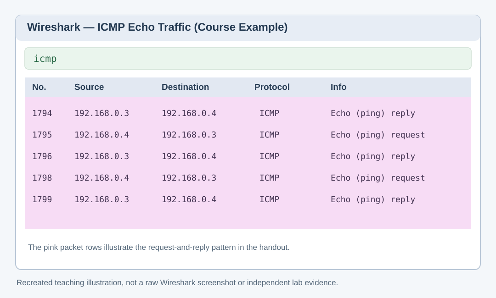

# Task 3 — ICMP Flood Exercise and Wireshark Observation

**Course:** Ethical Hacking and Network Defense  
**Platform:** ACI / Infosec Learning  
**Exercise:** DoS/DDoS Attacks and Attack Tools  
**Status:** Course reference documented; personal execution and evidence not yet verified

## Purpose

This exercise introduces ICMP-based denial-of-service traffic. The handout uses a finite series of ICMP Echo messages so that the traffic can be inspected using Wireshark. ICMP Echo Requests and Echo Replies help show whether a device responds to network probes.

The exercise title calls this an *ICMP flood attack*, but the displayed example sets a packet count of 100. The screenshots alone do not establish that the target was overwhelmed or that a denial of service occurred.

## Training environment

| Component | Value in the course instructions |
| --- | --- |
| Packet source | ACIKALI — 192.168.0.4 |
| Target | ACIWIN11 — 192.168.0.3 |
| Capture tool | Wireshark |
| Interface | Ethernet0 |
| Protocol | ICMP |
| Example packet count | 100 |

This hosted ACI training network is separate from the VirtualBox host-only network documented in the main repository.

## Course reference: Wireshark capture

*Figure 1. Recreated illustration based on the course's Wireshark screenshot. Pink rows show ICMP traffic between the Kali and Windows training addresses. This illustration is not a packet capture from my own lab.*

## Steps described in the provided handout

1. Open Wireshark on ACIWIN11 and start capturing from **Ethernet0**.
2. Switch to the authorized Kali training machine and clear its terminal display.
3. Run the instructor-provided, **finite 100-packet ICMP test** in the isolated course environment.
4. Observe the ICMP packets in Wireshark. The example shows pink-highlighted Echo Requests from 192.168.0.4 to 192.168.0.3 and Echo Replies traveling back.
5. Review the terminal's packet statistics.
6. Stop packet capture, then close Wireshark. The handout chooses to quit without saving.

## Example output shown in the handout

| Field | Screenshot example |
| --- | --- |
| Packets transmitted | 100 |
| Packets received | 100 |
| Packet loss | 0% |
| RTT min/avg/max | 0.4 / 4.2 / 11.2 ms |

**Important:** These numbers are from the training screenshots supplied with the assignment, not a confirmed capture of my own results. A successful response to 100 probes does not by itself establish a successful denial-of-service attack.

## What to look for

- The ICMP protocol in Wireshark's **Protocol** column
- Echo (ping) **request** and **reply** labels in the **Info** column
- The source and destination IP addresses for each direction
- Whether the observed packet counts match the instructor's finite test
- Whether the Windows training system remained responsive during the capture

## My own evidence (pending)

- [ ] Screenshot of my Wireshark capture with ICMP traffic
- [ ] Screenshot of my terminal's actual packet statistics
- [ ] Notes about any difference between my observations and the example
- [ ] Confirmation that capture ended and the lab machine remained usable

## Security takeaway

ICMP is useful for troubleshooting network reachability, but an excessive volume of ICMP traffic can consume bandwidth or device resources. Packet analysis helps distinguish ordinary diagnostic probes from unusually high traffic rates. Rate limiting, network filtering, and traffic monitoring are examples of relevant defenses.

## Reflection prompts

- What differences did I notice between an Echo Request and an Echo Reply?
- What can packet loss and round-trip time tell me?
- Why do I need traffic-rate and system-performance evidence before concluding a DoS attack succeeded?

**Source:** ACI / Infosec Learning, “Exercise 1 — DoS/DDoS Attacks and Attack Tools,” Task 3 screenshots, steps 1–8 supplied in the conversation.
