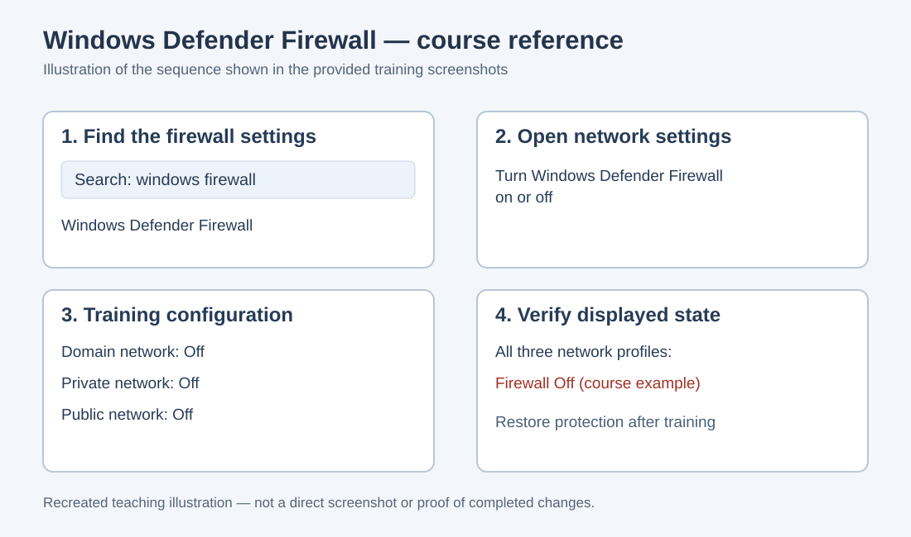

# Task 2 — Windows 11 Firewall Settings (Training Reference)

**Exercise:** DoS/DDoS Attacks and Attack Tools  
**Training platform:** ACI / Infosec Learning  
**Target machine in course instructions:** ACIWIN11  
**Status:** Reference documentation, not independently verified personal results

## Objective

This task illustrates how the Windows Defender Firewall settings affect network exposure. In the training handout, the Windows 11 machine's Domain, Private, and Public firewall profiles are switched off for a later exercise. These settings must only be changed on an explicitly authorized, isolated training machine.

## Course screenshots and settings

*Figure 1. Recreated reference illustration of the four screenshots shared from the course instructions. This is not a screenshot of my own completed activity.*

| Course step | What the handout shows |
| --- | --- |
| 1 | Open Windows Defender Firewall through the Windows search interface on ACIWIN11. |
| 2 | Navigate to the option for changing whether Windows Defender Firewall is on or off. |
| 3 | The example sets the Domain, Private, and Public network profiles to **Off**. |
| 4 | The example's overview screen shows the firewall disabled on all three profiles. |

## Security explanation

A host firewall filters network traffic according to security rules. Disabling it removes an important layer of protection and may allow traffic that would otherwise be blocked. Domain, Private, and Public are Windows network profiles; each has its own firewall state.

## Evidence and observations to confirm

- [ ] My own screenshot of the Windows Defender Firewall overview **before** the settings change.
- [ ] My own screenshot of the configured network profiles within the isolated training environment.
- [ ] My own screenshot of the resulting overview and firewall status.
- [ ] Confirmation that firewall protection was restored when the exercise ended.

## Reflection prompts

- Why is host-based firewall protection important?
- What is the difference between Domain, Private, and Public firewall profiles?
- Why should temporary security changes in a training environment be restored after testing?

**Source:** Infosec Learning / ACI, “Exercise 1 — DoS/DDoS Attacks and Attack Tools,” Task 2, steps 1–4 (course screenshots provided as reference).
